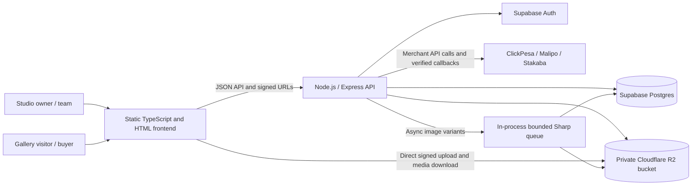

# InGallery System Architecture

## System at a glance

## Main components

### Frontend

- Vite serves the static HTML screens and TypeScript application code. `app.ts` contains shared frontend services and navigation behavior; `shared-nav.js` injects shared navigation into screens.
- Studio screens call authenticated API endpoints. Public gallery and checkout screens use public endpoints and temporary access credentials where applicable.
- The browser uploads originals and downloads media directly from R2 using short-lived signed URLs. The API handles authorization and metadata rather than proxying normal media bytes.
- Gallery sharing uses the gallery's existing public slug URL. A QR code can be generated from that canonical URL in the browser and offered as a downloadable image; no QR content should include an owner session, payment credential, or paid-access token. Scanning it follows the same public gallery authorization and preview rules as opening the link directly.

### API

- `server/index.ts` is the Express API: authentication, profile and studio operations, gallery management, public gallery access, orders, and payment provider callbacks/status checks.
- `server/supabase.ts` configures Supabase clients. The server-side service role is kept on the API host.
- `server/bootstrap.ts` applies registered SQL migrations when a Postgres connection string is configured.
- `server/r2.ts` creates signed R2 requests and performs object operations. `server/storage.ts` contains quota accounting helpers.
- `server/paymentCredentials.ts` encrypts/decrypts studio merchant credentials. `server/galleryAccess.ts` signs and verifies paid gallery access tokens.

### Persistence and storage

- Supabase Auth owns user identity. Supabase Postgres stores studio profiles, tenant and subscription/storage metadata, galleries, image metadata, orders, clients, team data, and payment settings. SQL migrations and row-level security policies are under `supabase/migrations/`.
- Each gallery stores a validated cover-design key in Supabase; the editor sends it through the authenticated gallery API, and the public gallery view uses it to style the cover.
- Cloudflare R2 stores private original images and derived variants. Object keys are scoped and randomized; public access is mediated by the API's policy checks and temporary signed URLs.
- Image variant state is persisted on gallery image records so queued work can be resumed after an API restart.

### Payment services

- A studio selects and configures its own supported merchant provider. Credentials are encrypted in the database; the API uses them for checkout and verification.
- Provider webhooks/callbacks and status polls are checked against the provider before an order is marked paid and access is issued.
- Gallery orders and their paid-access flow use each photographer's provider. Studio package payments use the platform's separately configured provider and activate a tenant plan only after verification.
- The platform-owner area is protected by Supabase authentication plus a database-backed `platform_admins` email allowlist checked on every admin API request. It can edit photographer accounts and subscriptions, package prices/features/limits, and a separately encrypted platform payment configuration. Photographer package checkout uses only the platform gateway; gallery payment configuration remains tenant-owned and separate. Provider status is verified before a database function atomically activates or changes a package subscription.

### Platform monitoring

- An API middleware records method, route template, status, duration, and authenticated user id for API calls. It excludes request bodies, query strings, passwords, and authorization headers. Logs are visible only through platform-admin APIs and records older than 30 days are pruned periodically.
- Platform overview counts registered profiles, tenants, active subscriptions, package payment revenue, API requests, and errors. It reports the current API process uptime; it is not a distributed tracing or external uptime-monitoring service.
- Performance analytics records anonymous browser visit hashes for published galleries, deduplicated once per gallery per day. The 30-day gallery view rate is the percentage of published galleries with a visit; client retention is the all-time share of email-matched paid clients with repeat successful orders.

## Key data flows

### Photo upload and processing

1. An authenticated owner asks the API for an upload URL.
2. The API checks gallery ownership and storage quota, reserves capacity, and returns a short-lived signed R2 URL.
3. The browser uploads the original directly to R2.
4. The API verifies the stored object and records its metadata, then queues image processing.
5. Sharp creates preview, medium, and large WebP variants and saves them to R2. The database tracks processing state and dimensions.
6. Gallery pages request permitted variants through API-issued signed URLs. Originals are available only after authorization.

### Gallery checkout and access

1. The visitor starts checkout for a gallery.
2. The API loads the gallery and owner's selected payment configuration, creates a pending order, and requests payment through the configured provider.
3. The browser waits on the pending-payment page while the API checks provider status or receives a callback.
4. The API confirms the payment with the provider, updates the order, and issues a signed access token for that order.
5. The visitor presents that token for paid originals/downloads. A pending or unverified payment does not unlock originals.

### Gallery QR sharing

1. The owner opens a gallery's share controls and the frontend builds the client URL from the current public gallery route and the gallery's public slug.
2. The frontend uses the `qrcode` library to render a PNG locally in the browser, preview it in a dialog, and offer it for download. The owner can also copy the underlying link.
3. A client scans the code; the device opens the same public gallery page as the regular share link. The QR is only an encoded URL: it does not authenticate the scanner, expose account data, grant paid access, or bypass preview rules.
4. If an owner changes the public URL or slug, a newly generated QR reflects the new URL. Existing codes continue to point only to the URL they encode and must not be redirected to another gallery without an explicit policy.

The QR code is generated locally and does not require storing QR image files or adding a database table; the gallery slug already identifies the public page. The URL is based on the current gallery route, so deployments should verify that generated links use the intended public frontend origin rather than a temporary preview/dev origin.

## Security boundaries

- Browser code must never receive Supabase service-role, R2 secret, or payment encryption keys.
- Authenticated API routes check user identity and ownership; database RLS provides a further boundary for user-owned records.
- Public gallery endpoints return only the fields and media permitted by the gallery's access state.
- Signed R2 URLs are temporary. Paid originals require an order-scoped signed token that the API verifies.
- Payment credentials are encrypted at rest. Payment success must be independently verified before issuing access.
- Private studio API responses such as storage usage are marked `private, no-store`. Locked public gallery metadata can use a short 30-second browser cache, varied by the gallery access-token header; paid/unlocked gallery responses are `no-store`. Public media variants use long-lived immutable caching in R2 because each upload has unique object keys.

## Runtime and deployment

- Build the frontend with `npm run build`; run the API with `npm run build:server` and `npm run start:server`.
- The frontend can be hosted as static assets. The API needs a Node.js host with Sharp and server-only Supabase, Postgres migration, and R2 configuration.
- Configure `SUPABASE_DB_URL` for startup migrations, `VITE_API_BASE_URL` for the browser API origin, and the server-side variables listed in `.env.example`/README.
- The image queue currently runs in each API process. Before running multiple API replicas or processing high volumes, move it to a dedicated durable worker/queue to avoid competing in-process workers.

## Repository map

| Path | Responsibility |
| --- | --- |
| `app.ts`, screen folders, `shared-nav.js` | Frontend logic, screens, and shared navigation |
| `server/` | Express API, auth, payments, image/storage helpers |
| `supabase/migrations/` | Database schema, indexes, and row-level security policies |
| `public/` | Public static assets and upload worker resources |
| `tests/` | Unit tests for access tokens, storage, credentials, checksums, and frontend helpers |
